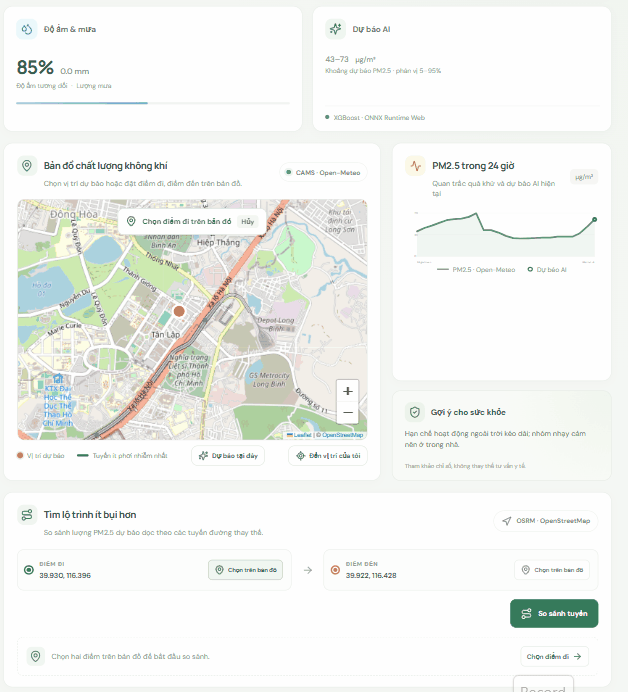

# 🌬️ AirWise — Lộ Trình Xanh, Thở An Lành
> **AirWise là ứng dụng web di động dự báo nồng độ bụi mịn $\text{PM}_{2.5}$ theo không gian – thời gian kèm khoảng bất định và gợi ý lộ trình di chuyển ít phơi nhiễm ô nhiễm nhất trực tiếp trên trình duyệt.**

[](https://github.com/your-username/urban-air-chitect-ydcc/actions)
[](LICENSE)
[](https://onnxruntime.ai/)

---

## 🎯 Ai Dùng & Việc Gì Thay Đổi?

* **Đối tượng sử dụng:** Người dân đô thị, người đi làm/đi học bằng xe máy, người chạy bộ/tập thể dục ngoài trời, phụ huynh có con nhỏ và nhóm người nhạy cảm với bệnh hô hấp.
* **Thay đổi thói quen di chuyển trong không khí đô thị:**
  * ❌ *Trước đây (Thụ động):* Nhìn chỉ số AQI chung chung từ một trạm quan trắc cách xa vài cây số, không biết đường mình sắp đi ô nhiễm ra sao và đành chấp nhận hít khói bụi trên tuyến đường quen thuộc.
  * ✅ *Với AirWise (Chủ động hành động):* 
    1. **Tìm đường sạch hơn (Exposure-Aware Routing):** Gợi ý tuyến đường giảm **20% – 30% lượng bụi hít vào** (dù chỉ đi xa hơn 2–3 phút so với tuyến ngắn nhất).
    2. **Biết trước rủi ro kèm khoảng an toàn:** Dự báo nồng độ $\text{PM}_{2.5}$ theo giờ kèm **khoảng tin cậy 90%** (ví dụ: $85\ [68 - 110]\ \mu\text{g/m}^3$) để chủ động đeo khẩu trang chuyên dụng hoặc dời giờ tập luyện ngoài trời.

---

## 📱 Màn Hình Ứng Dụng (Demo)

<!-- 
HƯỚNG DẪN THÊM ẢNH/GIF:
1. Quay video thao tác 5-10 giây trên điện thoại hoặc trình duyệt web (F12 Mobile view).
2. Dùng công cụ tạo GIF (như ScreenToGif, Ezgif.com) hoặc chụp ảnh màn hình đẹp.
3. Đặt file vào thư mục: docs/images/demo.gif (hoặc docs/images/app-preview.png).
4. Đường dẫn dưới đây sẽ tự động hiển thị ảnh/GIF lên trang chủ GitHub!
-->

<p align="center">
  
  <br>
  <em>Giao diện bản đồ chất lượng không khí & so sánh mức phơi nhiễm giữa các tuyến đường</em>
</p>

---

## 🚀 Trải Nghiệm Ngay

### 🌐 Dùng Thử Trực Tiếp (Web Demo)
👉 **[Truy cập AirWise Web App tại đây](https://urban-air-chitect-ydcc.vercel.app/)** *(Mở tốt nhất trên trình duyệt điện thoại)*

### 💻 Khởi Chạy Local (Trong 30 giây)

Yêu cầu: Đã cài [Node.js](https://nodejs.org/) (phiên bản $\ge 18$).

```bash
# 1. Đi vào thư mục giao diện web
cd webapp

# 2. Cài đặt các gói phụ thuộc
npm install

# 3. Khởi chạy ứng dụng
npm run dev
```
Mở trình duyệt tại: `http://localhost:5173` 

> **Chạy kiểm thử dự án:**
> * Kiểm thử giao diện: `cd webapp && npm test`
> * Kiểm thử pipeline ML: `python -m pytest -v` (16/16 tests pass)

---

## 🧠 Điểm Nhấn Kỹ Thuật (Edge / Web AI)

* **Không cần server AI đắt đỏ:** Toàn bộ mô hình **XGBoost Regressor** (gồm mô hình điểm và 2 mô hình phân vị $\alpha=0.05, 0.95$) được tối ưu và nén thành chuẩn **ONNX** ($< 2\text{MB}$).
* **Suy luận trực tiếp trên trình duyệt (`onnxruntime-web`):** Thiết bị người dùng tự tính toán dự báo với **độ trễ $< 5\text{ms}$**, hoạt động mượt mà và bảo mật tuyệt đối dữ liệu vị trí.
* **Độ chính xác cao:** Đạt **$R^2 = 0.9719$**, $\text{RMSE} = 17.63\ \mu\text{g/m}^3$ trên tập kiểm thử độc lập và $\text{Macro-F1} = 0.8420$ khi quy đổi sang 6 mức AQI chuẩn.

---

## 📊 Nguồn Dữ Liệu & Tuyên Bố Giới Hạn

* **Nguồn dữ liệu:**
  * Dữ liệu huấn luyện và kiểm chứng: Chuỗi thời gian quan trắc chất lượng không khí lịch sử đa trạm (UCI Beijing Multi-Site Air Quality Dataset).
  * Dữ liệu khí tượng thời gian thực: [Open-Meteo API](https://open-meteo.com/) (nhiệt độ, độ ẩm, áp suất, tốc độ và hướng gió).
  * Đồ thị mạng lưới giao thông & định tuyến: OpenStreetMap & [OSRM API](http://project-osrm.org/).
* **⚠️ Tuyên bố giới hạn (Disclaimer):**
  > *Dự báo từ AirWise là kết quả ước lượng từ mô hình toán học và học máy phục vụ mục đích hỗ trợ quyết định sinh hoạt cộng đồng; hệ thống không thay thế các trạm quan trắc chuẩn quốc gia của cơ quan quản lý nhà nước và không cấu thành lời khuyên y tế chuyên khoa.*
